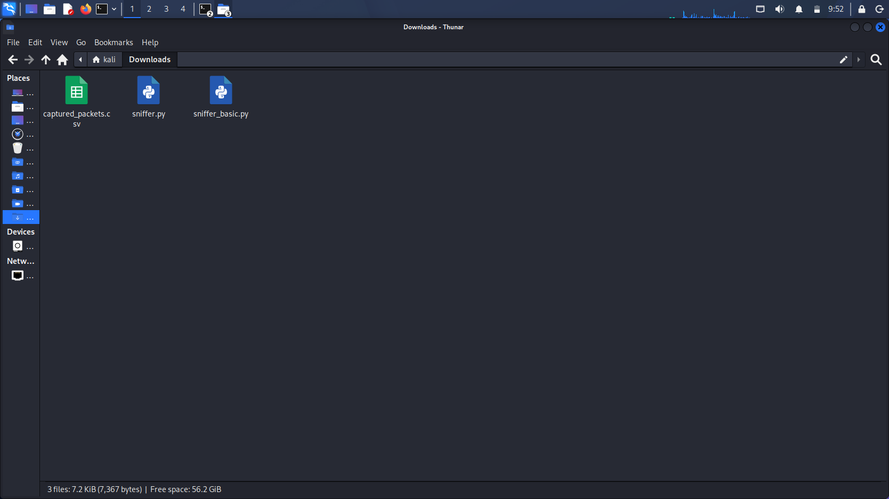

# Scapy Network Packet Sniffer

**A lightweight Python CLI for capturing authorized network traffic, inspecting packet metadata, and exporting a durable CSV record.**

[](https://www.python.org/)
[](https://scapy.net/)
[](https://github.com/sundasmohsin295-dotcom/Scapy-Network-Packet-Sniffer/stargazers)
[](LICENSE)

Use it for network troubleshooting, protocol learning, and small authorized capture sessions. The sniffer prints a live summary, appends packet metadata to CSV, and reports protocol totals when it finishes. It does not retain packet objects in memory.

> Capture only on networks and interfaces you own or are explicitly authorized to monitor. Captures can expose sensitive information.

## See it in action



## Features

- Captures Ethernet frames, including ARP and non-IP traffic.
- Recognizes IPv4, IPv6, TCP, UDP, ICMP, and ICMPv6.
- Writes UTC timestamps, endpoints, protocol, packet number, and frame length to CSV.
- Appends to an existing CSV and writes a header only when the file is empty.
- Flushes each row so an interrupted capture still leaves completed records on disk.
- Supports interface selection, packet limits, BPF filters, and quiet mode.
- Prints mutually exclusive protocol totals that add up to the total frame count.

## Requirements

- Python 3.10 or newer
- Scapy 2.x
- Npcap on Windows, or libpcap on Linux/macOS
- Permission to capture on the selected interface

## Quick start

Clone the repository and enter its directory:

```bash
git clone https://github.com/sundasmohsin295-dotcom/Scapy-Network-Packet-Sniffer.git
cd Scapy-Network-Packet-Sniffer
```

Create a virtual environment and install dependencies:

```bash
python -m venv .venv
```

Activate it, then install the requirements:

```bash
# Linux/macOS
source .venv/bin/activate
python -m pip install -r requirements.txt
```

```powershell
# Windows PowerShell
.venv\Scripts\Activate.ps1
python -m pip install -r requirements.txt
```

On Windows, install [Npcap](https://npcap.com/#download) as well. On Linux, install libpcap with your distribution's package manager if needed. Use the least privilege required for capture on your system.

## Usage

List available interfaces:

```bash
python sniffer.py --list-interfaces
```

Capture 50 packets on an interface (50 is the default):

```bash
python sniffer.py --interface eth0
```

Capture 200 packets and save them to a chosen file:

```bash
python sniffer.py --interface eth0 --count 200 --output captures/session.csv
```

Capture matching HTTPS traffic until stopped with **Ctrl+C**:

```bash
python sniffer.py --interface eth0 --count 0 --filter "tcp port 443"
```

Suppress per-packet console output while retaining the CSV and final summary:

```bash
python sniffer.py --interface eth0 --quiet
```

### Options

| Option | Description |
| --- | --- |
| `-i`, `--interface` | Interface to capture on. If omitted, Scapy chooses its default. |
| `-c`, `--count` | Number of packets to capture. Defaults to `50`; use `0` to capture until interrupted. |
| `-o`, `--output` | CSV destination. Defaults to `captured_packets.csv`. Parent directories are created as needed. |
| `-f`, `--filter` | Optional libpcap/BPF capture filter, such as `"tcp port 443"`. |
| `--list-interfaces` | Print available interfaces and exit. |
| `-q`, `--quiet` | Hide per-packet console lines. |
| `-h`, `--help` | Show all command-line options. |

Interface names vary by operating system. Run `--list-interfaces` to find the name Scapy expects. Packet numbering starts at 1 on each run; appending another run adds rows to the same CSV with packet numbering restarted. Press Ctrl+C to stop early and close the output cleanly.

## CSV format

Each row contains:

`Timestamp (UTC)`, `Packet #`, `Source MAC`, `Destination MAC`, `Source IP`, `Destination IP`, `Protocol`, `Length (bytes)`

Addresses are `N/A` when the captured frame does not contain the corresponding layer. Protocol buckets are exclusive: a TCP packet is counted as TCP rather than again as IPv4 or IPv6. Therefore, all protocol totals sum to `Total packets`. When a BPF filter is active, those totals describe only packets that matched it.

## How it works

Scapy delivers each matching packet to a callback. The callback identifies one protocol bucket, extracts available link and network endpoints, writes one CSV row, and flushes it. Packet objects are not accumulated, so memory use does not grow with capture length. When capture ends, the CLI prints totals for TCP, UDP, ICMP, ICMPv6, ARP, IPv4, IPv6, and other frames.

## Privacy and authorization

Use this tool only on networks and interfaces you own or have explicit permission to monitor. Packet metadata and captures may reveal device addresses, IP addresses, and other sensitive details. Protect the output file, share it only with authorized people, and remove it when it is no longer needed. A capture filter narrows what Scapy records; it does not grant authorization to monitor that traffic.

## Contributing

Bug reports, clear documentation fixes, and focused improvements are welcome. Please include your operating system, Python and Scapy versions, the command you ran, and a redacted error or sample when reporting a problem. Never attach an unredacted capture containing private traffic.

## License

This project is available under the [MIT License](LICENSE).
